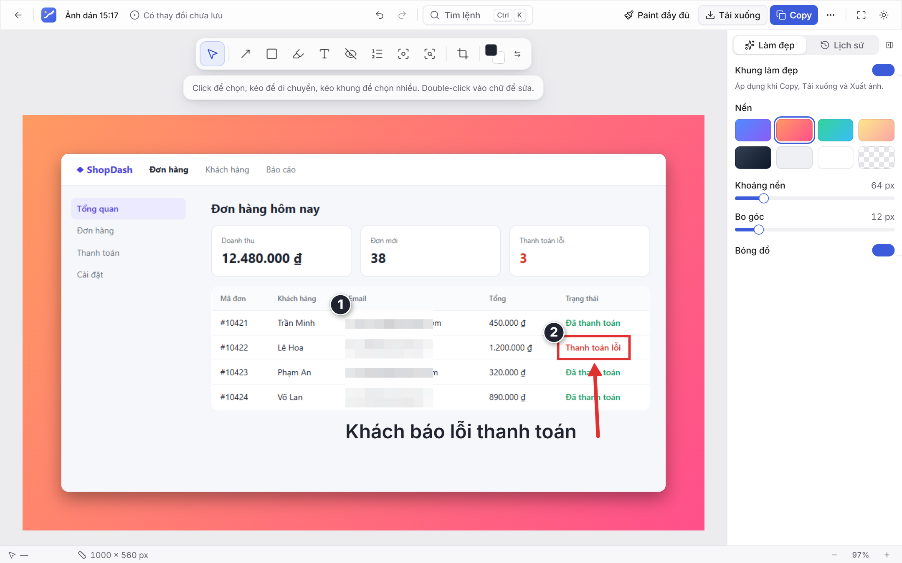
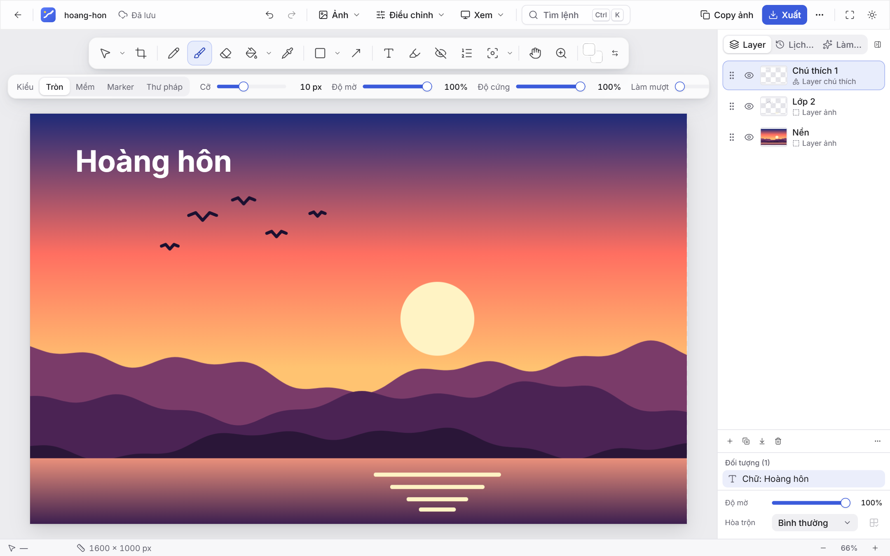
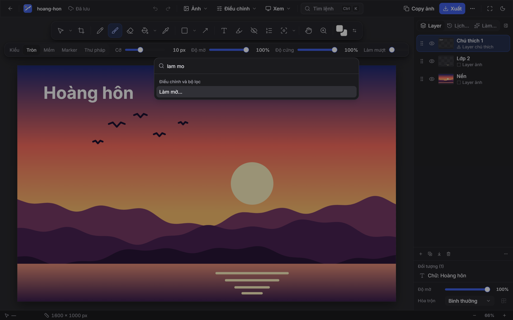
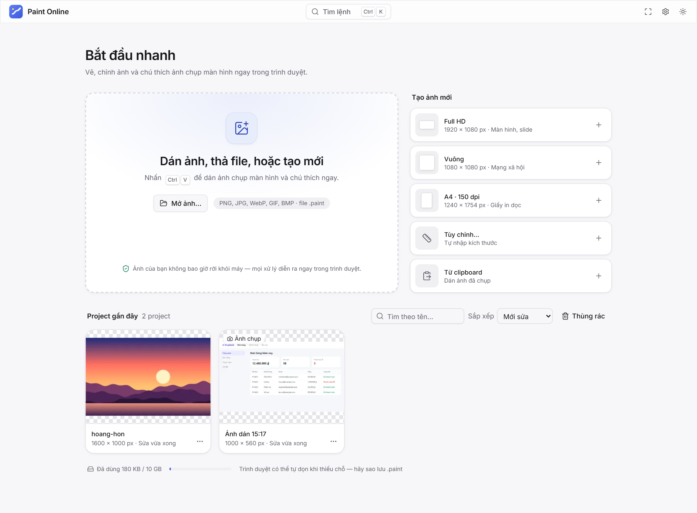

<div align="center">


# Paint Online

**Vẽ, chỉnh ảnh và chú thích ảnh chụp màn hình ngay trong trình duyệt.**<br />
Không tài khoản · Không máy chủ · Ảnh không bao giờ rời khỏi máy bạn.

**[🌐 Dùng thử Paint Online](https://paint-online-awt.pages.dev)**

[](https://github.com/nkcuongdev/PaintOnline/actions/workflows/ci.yml?query=branch%3Amain)


[Tính năng](#tính-năng) · [Bắt đầu](#bắt-đầu) · [Phím tắt](#phím-tắt) · [Sao lưu](#dữ-liệu-và-sao-lưu) · [Tài liệu](#tài-liệu)



</div>

## Vì sao là Paint Online

|                       |                                                                                     |
| --------------------- | ----------------------------------------------------------------------------------- |
| 🔒 **Riêng tư**       | Mọi xử lý diễn ra trong trình duyệt. Không backend, không analytics, không gửi ảnh. |
| ⚡ **Mở tab là dùng** | Dán ảnh chụp màn hình bằng Ctrl+V, chú thích xong rồi bấm Copy trong vài giây.      |
| 💾 **Không mất bài**  | Tự động lưu vào IndexedDB, khôi phục sau khi đóng tab hay trình duyệt bị treo.      |
| ✈️ **Dùng offline**   | Là PWA: tắt mạng vẫn mở và vẽ bình thường. Cài đặt app là tùy chọn.                 |

## Tính năng

<table>
<tr>
<td width="50%" valign="top">

### 📸 Chú thích ảnh chụp màn hình

- Mũi tên, khung, bút dạ quang, chữ, số thứ tự tự đánh số
- **Che thông tin**: tô kín, khảm hoặc làm mờ, sửa lại được bất cứ lúc nào
- Spotlight làm tối phần còn lại, phóng to một vùng
- **Làm đẹp**: nền gradient, khoảng nền, bo góc, bóng đổ
- Kiểu nhanh cho mũi tên, khung, chữ

</td>
<td width="50%" valign="top">

### 🖌️ Vẽ và chỉnh ảnh

- Cọ (tròn, mềm, marker, thư pháp) có áp lực bút, bút chì, tẩy, tô màu, Gradient
- **Layer** với 16 blend mode, opacity, khóa, gộp; History nhảy tới bất kỳ bước nào
- Vùng chọn chữ nhật, elip, Lasso, Đũa thần; di chuyển, xoay, co giãn pixel
- Crop, Trim, Resize, Canvas size, xoay, lật
- 10 bộ lọc: sáng, tương phản, bão hòa, sắc độ, đen trắng, đảo màu, sepia, làm mờ, làm sắc nét, khảm

</td>
</tr>
<tr>
<td width="50%" valign="top">

### ⌨️ Thao tác nhanh

- **Command Palette** (Ctrl+K), tìm không dấu: gõ "lam mo" ra "Làm mờ"
- Zen mode, toàn màn hình, mini toolbar cạnh vùng chọn
- Lưới, thước đo, bám lưới, căn chỉnh đối tượng
- HUD đổi cỡ cọ bằng Alt + kéo chuột phải

</td>
<td width="50%" valign="top">

### 📁 Project và file

- Trang chủ có tìm kiếm, sắp xếp, thùng rác giữ 7 ngày
- Xuất PNG / JPG / WebP, chọn tỉ lệ và chất lượng
- File `.paint` (ZIP chứa PNG từng layer) để sao lưu, chuyển máy
- Lưu nhanh ra file: Ctrl+S ghi đè thẳng file `.paint` (Chrome, Edge)

</td>
</tr>
</table>

<div align="center">


<br />
<sub>Chế độ Paint với layer ảnh và layer chú thích · Giao diện tối và Command Palette</sub>
</div>

<details>
<summary>Trang chủ</summary>
<br />

</details>

## Bắt đầu

Để chạy hoặc phát triển dự án trên máy, cần **Node.js 22 hoặc 24** và npm 10+.

```bash
npm install
npm run dev
```

Mở địa chỉ Vite in ra (mặc định `http://localhost:5173`), rồi dán một ảnh chụp màn hình bằng
**Ctrl+V**.

Build bản production:

```bash
npm run build
npm run preview
```

Toàn bộ app là trang tĩnh trong `dist/`, deploy được lên Cloudflare Pages, Netlify hay bất kỳ host
tĩnh nào. Xem [hướng dẫn deploy](docs/DEPLOY.md).

Website hiện được triển khai trên **Cloudflare Pages**. Mỗi lần push hoặc merge vào `main`,
GitHub Actions tự chạy kiểm tra, build và deploy khi các kiểm tra bắt buộc đạt. Các bộ test trình
duyệt chạy song song trên Chromium, Firefox và WebKit. Theo dõi tiến trình tại
[GitHub Actions](https://github.com/nkcuongdev/PaintOnline/actions/workflows/ci.yml?query=branch%3Amain).

**Trình duyệt hỗ trợ:** Chrome, Edge, Firefox (2 bản mới nhất), Safari 17+ trên máy tính. Bản v1.0
thiết kế cho màn hình laptop từ 1024 px.

## Phím tắt

| Phím                          | Việc                  | Phím             | Việc                |
| ----------------------------- | --------------------- | ---------------- | ------------------- |
| <kbd>Ctrl</kbd>+<kbd>V</kbd>  | Dán ảnh, mở chú thích | <kbd>V</kbd>     | Chọn                |
| <kbd>Ctrl</kbd>+<kbd>K</kbd>  | Command Palette       | <kbd>B</kbd>     | Cọ                  |
| <kbd>Ctrl</kbd>+<kbd>Z</kbd>  | Hoàn tác              | <kbd>U</kbd>     | Hình (khung, elip…) |
| <kbd>Ctrl</kbd>+<kbd>S</kbd>  | Lưu ngay              | <kbd>T</kbd>     | Chữ                 |
| <kbd>[</kbd> <kbd>]</kbd>     | Đổi cỡ cọ             | <kbd>K</kbd>     | Che thông tin       |
| <kbd>&#92;</kbd>              | Zen mode              | <kbd>N</kbd>     | Số thứ tự           |
| <kbd>Shift</kbd>+<kbd>F</kbd> | Toàn màn hình         | <kbd>M</kbd>     | Vùng chọn           |
| <kbd>?</kbd>                  | Bảng phím tắt đầy đủ  | <kbd>Space</kbd> | Giữ để kéo ảnh      |

## Dữ liệu và sao lưu

> [!WARNING]
> Mọi project nằm trong IndexedDB của **một** trình duyệt trên **một** máy, không có đồng bộ đám mây.
> Dữ liệu có thể mất khi xóa dữ liệu duyệt web, khi trình duyệt tự dọn lúc thiếu dung lượng, khi
> dùng cửa sổ ẩn danh, hoặc với Safari sau 7 ngày không mở trang (trừ khi cài app lên Dock).

Cách giữ an toàn:

1. **Bật lưu trữ bền vững:** Cài đặt → Lưu trữ → "Yêu cầu lưu bền vững".
2. **Tải bản sao lưu `.paint`** cho project quan trọng: menu ⋯ → "Tải bản sao lưu .paint". Trang chủ
   nhắc khi đã lâu chưa sao lưu.
3. **Lưu nhanh ra file** (Chrome, Edge): menu ⋯ → "Lưu ra file .paint…". Đặt file trong thư mục
   OneDrive / Google Drive / Dropbox nếu muốn có bản trên đám mây.
4. **Chuyển máy:** mang file `.paint` sang, thả vào trang chủ.

> [!NOTE]
> Vùng che thông tin không phá hủy ảnh, nên file `.paint` vẫn chứa ảnh gốc bên dưới. Khi xuất, chọn
> "Áp dụng vĩnh viễn vùng che" để pixel gốc bị thay hẳn trước khi ghi file.

Gặp lỗi? Cài đặt → Nhật ký lỗi → "Tải nhật ký (JSON)" rồi gửi file đó. Nhật ký chỉ nằm trong trình
duyệt, app không gửi gì ra ngoài.

## Công nghệ

- **Canvas Engine tự viết** bằng TypeScript thuần trên Canvas 2D: render theo vùng bẩn, undo theo tile
  256×256 lưu trên GPU, ngân sách bộ nhớ trung tâm.
- **Web Worker** cho tô màu, bộ lọc, mã hóa PNG, nén; UI không treo kể cả với ảnh 6000×4000.
- **React 19 + Zustand + Tailwind CSS 4 + shadcn/ui** cho giao diện; IndexedDB qua `idb`.
- **Vitest** (unit, component, browser mode) và **Playwright** E2E trên Chromium, Firefox, WebKit.

Trong đợt đo v1.0 ngày 18/10/2026 trên Dell Vostro 5568 (Core i7-7500U, RAM 7,9 GB), kịch bản
Chromium với ảnh 4K × 5 layer đạt frame p95 khoảng 17,4 ms, undo 5 ms; JS khởi động khoảng 170 KB
gzip. Đây là số liệu trên cấu hình thử nghiệm; hiệu năng thực tế phụ thuộc thiết bị, trình duyệt
và độ phức tạp của ảnh. Xem [kết quả benchmark và giới hạn đã biết](docs/DEVELOPMENT.md#benchmark).

## Tài liệu

| Tài liệu                                  | Nội dung                                                        |
| ----------------------------------------- | --------------------------------------------------------------- |
| [Kiến trúc](docs/ARCHITECTURE.md)         | Các lớp, module của Engine, luồng dữ liệu, lưu trữ              |
| [Quyết định kiến trúc](docs/DECISIONS.md) | 29 ADR: vì sao chọn cách làm hiện tại                           |
| [Phát triển](docs/DEVELOPMENT.md)         | Lệnh, test, benchmark, ngưỡng hiệu năng, checklist kiểm thử tay |
| [Deploy](docs/DEPLOY.md)                  | Cloudflare Pages, Netlify, GitHub Pages, cập nhật phiên bản     |

## Giấy phép

[MIT](LICENSE)
